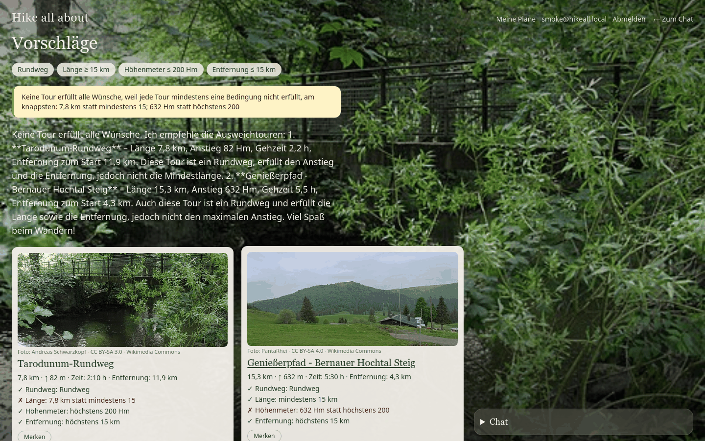
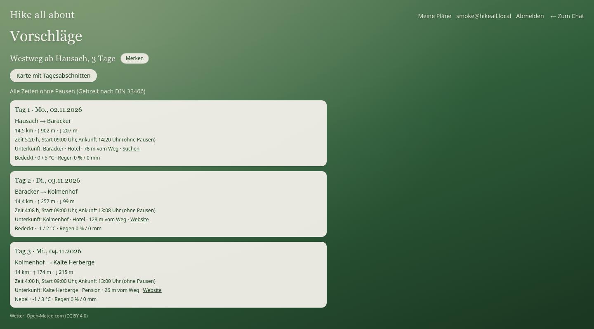
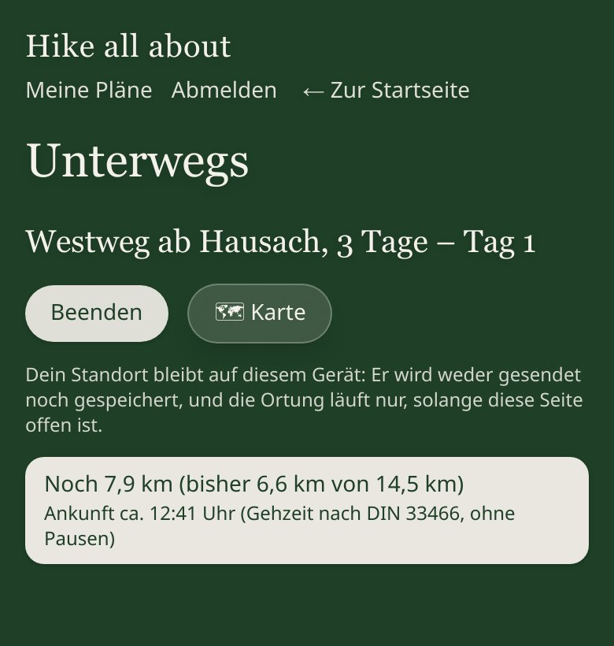
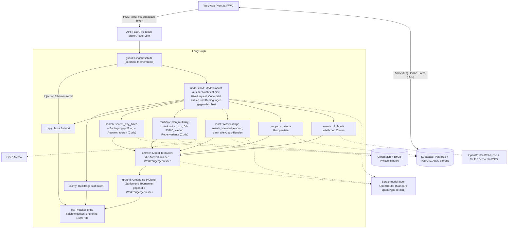

# Hike all about

Ein Wanderplaner für den Schwarzwald, den man über einen KI-Chat bedient. Er plant Tagestouren und Mehrtagestouren auf Westweg, Mittelweg und Ostweg mit Unterkünften, Gehzeiten und Wetter. Jede Strecke kommt aus der Datenbank, nicht vom Sprachmodell. Jede Zahl im Antworttext prüft der Code gegen die Ergebnisse der Werkzeuge.

## Showcase

**Video: folgt** <!-- Link zum Demo-Video hier eintragen -->

| Unerfüllbarer Wunsch: ehrlich benannt, Ausweichtouren mit genau einer verletzten Bedingung | Mehrtagesplan mit Unterkünften, Ankunftszeiten und Wetter | „Unterwegs“ auf dem Handy |
|---|---|---|
|  |  |  |

Alle Screenshots stammen aus der lokal laufenden App vom 2026-10-31 mit dem echten Modell (`openai/gpt-4o-mini`). Die Position für „Unterwegs“ ist simuliert: ein Punkt auf Tag 1 des Plans, die Uhr des Browsers steht auf 10:00. Die Bilder 02, 10, 11 und 12 sind nach den Fixes vom selben Tag neu aufgenommen.

<details>
<summary>Alle Screenshots</summary>

Die Bilder zeigen noch die Optik vor dem Umbau vom 2026-11-01 (Fotohintergrund, eigene Vorschlagsseite). Seitdem ist die App dunkelgrün, die Vorschläge stehen als Kacheln direkt neben dem Chat, und Tour- und Planseite zeigen die Karte eingebettet. Neue Screenshots folgen mit dem neuen Video.

1. [Startseite](docs/showcase/01-startseite.jpg)
2. [Tagestouren zu „Rundweg 10–14 km um Hinterzarten, unter 400 Hm“](docs/showcase/02-tagestouren.jpg): Karten mit ✓ je Bedingung, der Antworttext nennt passende Touren ohne Unerfüllbarkeits-Satz. Die Sternchen im Text sind Markdown des Modells; seit dem 2026-11-01 stellt die App es dar (fett, kursiv, Links, Listen), der Screenshot ist älter.
3. [Rückfrage „Feldberg“ und ehrlich benannte Unerfüllbarkeit im Chat](docs/showcase/03-unerfuellbar-chat.jpg)
4. [Ausweichtouren mit der einen verletzten Bedingung](docs/showcase/04-unerfuellbar-ausweichtouren.png)
5. [Mehrtagesplan mit Wetter (Open-Meteo)](docs/showcase/05-mehrtagesplan-wetter.png)
6. [Karte mit Tagesabschnitten](docs/showcase/06-tagesabschnitte-karte.png)
7. [Routenseite mit Fotos, Lizenzen und Gruppen in der Nähe](docs/showcase/07-routenseite-fotos.png)
8. [Karte einer Tagestour mit Unterkünften (basemap.de)](docs/showcase/08-routenkarte.png)
9. [Wissensfrage mit Quellen und Lizenz](docs/showcase/09-wissensfrage-quellen.jpg)
10. [„Unterwegs“ auf dem Handy](docs/showcase/10-unterwegs-handy.jpg)
11. [„Unterwegs“ mit Position auf der Karte](docs/showcase/11-unterwegs-karte-handy.jpg)
12. [Startseite auf dem Handy](docs/showcase/12-startseite-handy.jpg)

</details>

## Problem

Eine echte Planung war der Anlass: drei Tage Schwarzwald. Dafür habe ich bekannte Routen gesucht (Westweg, Komoot, Schwarzwaldverein) und Empfehlungen verglichen. Dann habe ich drei Zimmer hintereinander gebucht, so dass jeden Tag etwa 15 km bis zur Unterkunft am späten Nachmittag lagen, mit einem Plan B für Regen. Das hat gut funktioniert, kostete aber mehrere Tage Vorbereitung. Schwierig war nicht, einen Weg zu finden. Schwierig war, dass **Strecke, Übernachtung und Wetter zusammenpassen**.

Der Vorgänger HikeAI (Sprint 2) wurde im Review vor allem für drei Dinge kritisiert:

- **Wünsche stillschweigend fallen gelassen.** „Rundweg, unter 200 Hm, über 15 km, Feldberg“ ergab erst nichts. Danach kam ein Vorschlag *ohne* Rundweg, ohne Hinweis darauf.
- **Mit den Ergebnissen ließ sich nichts anfangen.** Es gab keine Route und keine Planung, nur eine Liste.
- **Die Herkunft der Daten war nicht nachvollziehbar.** Sie kamen fast nur aus OSM.

Hike all about ist deshalb neu gebaut. Im Vordergrund steht das Planen, der Chat ist die Hauptbedienung, und die Regeln für Ehrlichkeit stehen im Code statt im Prompt.

## Was die App kann

1. **Mehrtagestour planen:** teilt Westweg (West- und Ostvariante), Mittelweg oder Ostweg ab einem Etappenort in Tage mit Zielstrecke. Tagesziel ist eine Unterkunft höchstens 1 km vom Weg. Dazu kommen die Ankunftszeit nach DIN 33466, das Wetter und an Regentagen eine Regenvariante mit der Bahn.
2. **Tagestouren:** schlägt höchstens 5 Touren im Umkreis eines Startorts vor, jede mit ✓ oder ✗ je Bedingung.
3. **Ehrlicher Umgang mit Wünschen:** Erfüllt keine Tour alle Bedingungen, sagt der Code das mit Begründung. Er zeigt dann Touren, die genau eine Bedingung verletzen, und nennt die Abweichung (z. B. „632 Hm statt höchstens 200“).
4. **Chat im Vordergrund:** Der Plan entsteht im Gespräch und lässt sich dort ändern, etwa mit „Tag 3 kürzer“ oder „Und eine Regenvariante für Tag 1?“.
5. **Wissensfragen mit Quelle:** beantwortet Fragen wie „Wie ist der Westweg markiert?“ aus einem Index mit Wikipedia, Wikivoyage und eigenen Texten, immer mit Quelle und Lizenz. Ohne Quelle gibt es keine Antwort.
6. **Unterwegs (PWA):** zeigt auf dem Handy die eigene Position auf dem Tagesabschnitt, die Restkilometer und die geschätzte Ankunft. Alles wird im Browser berechnet, nichts wird aufgezeichnet.
7. **Bilder:** Touren und Etappen haben Bilder von Wikimedia Commons mit Urheber und Lizenz. Man kann sie durchblättern, als Hintergrund wählen und eigene, private Fotos hinzufügen.
8. **Konten:** Anmeldung über Supabase Auth. Gemerkte Pläne erscheinen unter „Meine Pläne“, auch auf dem Handy. Planen im Chat und Fotos hochladen gehen nur angemeldet.

Dazu kommen eine kuratierte Liste von Wandervereinen und eine Suche nach Laufveranstaltungen mit Quellenpflicht (siehe [Gruppen und Läufe](#gruppen-und-läufe)).

## Wie es funktioniert

Die Web-App (Next.js, als PWA installierbar) spricht mit Supabase für Anmeldung, gemerkte Pläne und Fotos. Für den Chat spricht sie mit der Python-API (FastAPI). Die API prüft das Supabase-Token und das Rate-Limit und führt dann einen LangGraph-Graphen aus. Die Knoten unten heißen so wie in `backend/src/hikeall/agent/graph.py` (`build_graph`).



Die Arbeit ist so aufgeteilt:

- **Das Modell** macht aus der Nachricht eine strukturierte Anfrage und formuliert die Antwort. In `react` wählt es außerdem Werkzeuge aus.
- **Der Code** übernimmt Zahlen und Bedingungen aus dem Modell nur, wenn sie in der Nachricht stehen. Er sucht die Touren, prüft jede Bedingung, wählt Ausweichtouren, plant die Tage und rechnet Gehzeiten.
- **Die Grounding-Prüfung** sucht jede Zahl mit Einheit im Antworttext in den Werkzeugergebnissen der Runde. Nicht belegte Zahlen ersetzt sie durch „?“. Tournamen, die in den Ergebnissen nicht vorkommen, bekommen einen Hinweis.
- **Die ehrlichen Sätze schreibt der Code selbst.** Das sind „Keine Tour erfüllt alle Wünsche, weil …“, Lücken bei Unterkünften und „Zeiten ohne Pausen“. Sie stehen wörtlich vor dem Text des Modells.

## Daten und Lizenzen

Alles liegt in einer lokalen Supabase-Datenbank. Die Import-Skripte (`hikeall import-*`, siehe `Makefile`) erzeugen einen festen Stand, die App fragt OSM zur Laufzeit nicht ab. Wege, Etappen, Unterkünfte, Orte und Punkte verweisen je Zeile auf eine Quelle mit Lizenz (Tabelle `sources`), Bilder tragen Urheber und Lizenz selbst. Die Karte zeigt die Attribution für OSM und BKG, jedes Bild seinen Urheber und seine Lizenz. Die Mengen unten wurden am 2026-10-31 aus der Datenbank abgefragt, die Abfrage steht als Kommentar daneben.

| Datenart | Quelle und Lizenz | Menge |
|---|---|---|
| Fernwege und Etappen | Wegverlauf: OSM-Relationen (ODbL). Etappeneinteilung (Start, Ziel, km) als Fakten von Schwarzwald Tourismus (Westweg) und vom Schwarzwaldverein (Mittelweg, Ostweg), ohne übernommene Texte | 4 Linien: Westweg West 286,1 km, Westweg Ost 288,6 km, Mittelweg 224,8 km, Ostweg 244,5 km; zusammen 46 Etappen <!-- select id, round(length_km::numeric,1) from trails where kind='long_distance'; select count(*) from stages; --> |
| Tagestouren | OSM-Wanderrelationen (ODbL). 1712 gescannt, automatisch gefiltert (Lücken, Länge), danach 255 weitere abgelehnt. Diese Ablehnungen sind von Claude vorgeschlagen, noch nicht von Ali bestätigt (siehe [Offene Prüfungen](#offene-prüfungen-vor-abgabe)). Entscheidung und Grund je Relation in `data/curated/day_hikes.csv` | 122 Touren <!-- select count(*) from trails where kind='day_hike'; CSV: 1712 Zeilen, 1335 automatisch verworfen, 255 mit manual_reason „Vorschlag Claude: …“ verworfen --> |
| Unterkünfte | OSM (Hotel, Pension, Ferienwohnung, Chalet, Hostel, Hütte, Campingplatz; ODbL), Website-Link, falls vorhanden | 1814 Unterkünfte, 3115 Verknüpfungen mit Wegen <!-- select count(*) from lodgings; select kind, count(*) from lodgings group by kind; select count(*) from trail_lodgings; --> |
| Einkehr, Aussicht, Gipfel, Wasserfälle, Hütten, Bahnhöfe | OSM (ODbL). In `sources` steht für alle OSM-Daten eine Zeile `osm`: „OpenStreetMap contributors (Overpass API)“, abgerufen 2026-10-28. Orte und Punkte kann der Import auch aus dem Geofabrik-Extrakt Baden-Württemberg lesen (`make places`, Extrakt mit Stand 2026-10-28); welcher der beiden Wege den aktuellen Stand erzeugt hat, hält `sources` nicht fest | 767 Einkehr, 460 Aussichtspunkte, 179 Gipfel, 57 Wasserfälle, 31 Hütten, 40 Bahnhöfe und Haltepunkte <!-- select kind, count(*) from pois group by kind; --> |
| Orte (Startorte) | OSM (wie oben; ODbL) | 3955 Orte <!-- select count(*) from places; --> |
| Höhenprofile | Copernicus DEM GLO-30 (© DLR e.V. 2010–2014 und © Airbus Defence and Space GmbH 2014–2018, bereitgestellt unter COPERNICUS von EU und ESA), beim Import auf jede Linie gerechnet | alle Linien |
| Bilder | Wikimedia Commons (Geo-Suche entlang der Linie). Urheber und Lizenz stehen je Bild in der Datenbank und am Bild. Eigene Uploads sind privat (Supabase Storage) | 849 Commons-Bilder zu 118 Touren und Wegen <!-- select source, count(*) from photos group by source; select count(distinct trail_id) from photos where source='commons'; --> |
| Wissensindex (RAG) | 15 Wikipedia- und 3 Wikivoyage-Artikel (CC BY-SA 4.0, `data/knowledge/sources.yaml`) und 4 eigene Texte (`data/knowledge/*.md`), ChromaDB + BM25 | 551 Abschnitte im Index <!-- sqlite3 data/chroma/chroma.sqlite3 'select count(*) from embeddings' --> |
| Gruppen | Kuratierte Liste `data/curated/groups.csv`, Link und Prüfdatum je Eintrag | 24 Einträge, alle mit Status „vorschlag“ <!-- select status, count(*) from groups group by status; --> |
| Karte | basemap.de-Vektorkacheln (BKG, CC BY 4.0), zur Laufzeit geladen | – |
| Wetter | Open-Meteo.com (CC BY 4.0), zur Laufzeit für Tage bis 14 Tage ab heute | – |

## Evaluation

Ein fester Testsatz von 52 Anfragen (`data/eval/cases.yaml`) läuft mit `make eval` gegen den echten Agenten: echtes Modell, echte Datenbank, echter Index. Geprüft wird mit Code, nicht von Hand und nicht von einem zweiten Modell. Das Wetter kommt aus gespeicherten Open-Meteo-Daten, damit der Lauf wiederholbar ist. Methode, Kennzahlen und Grenzen stehen in [docs/evaluation/README.md](docs/evaluation/README.md).

SMART-Ziele, Lauf vom 2026-10-31 mit `openai/gpt-4o-mini` ([Bericht](docs/evaluation/bericht-2026-10-31-openai-gpt-4o-mini.md)):

| Ziel | Ist-Wert | Ergebnis |
|---|---|---|
| 0 % erfundene Touren | 0 von 74 Tour-IDs nicht in der Datenbank, 0 unbelegte Tournamen im Text | erreicht |
| ≤ 2 % nicht belegte Zahlen | 0 von 518 Zahlen (0,0 %) | erreicht |
| 100 % offen benannte Unerfüllbarkeit | 8 von 8 Fällen | erreicht |
| Recall@5 ≥ 0,8 | 10 von 10 Fällen (1,00) | erreicht |

Bestanden sind 52 von 52 Fällen, aufgeteilt in die Gruppen erfüllbar 12, unerfüllbar 8, Mehrtag 9, Änderung 5, Wissen 10, Eingabeschutz 5 sowie Gruppen und Läufe 3. Im Abgleich mit OSM wichen 0 von 82 Touren und Plan-Tagen um mehr als 2 % von der OSM-Linie ab. Ein Lauf kostete 0,0282 USD.

Zusätzlich zu den SMART-Zielen zählt der Lauf falsche Unerfüllbarkeits-Behauptungen: Antworten, die „Keine Tour erfüllt alle Wünsche“ sagen, obwohl der Code nicht ausweichen musste. Ergebnis: 0 von 21 erfüllbaren Fällen (12 Tagestouren, 9 Mehrtagespläne), der Code musste keinen solchen Satz entfernen. Vor dem Fix schrieb das Modell den Satz in 12 von 12 erfüllbaren Tagestour-Fällen, ohne dass ein Fall rot wurde ([Befunde](docs/evaluation/README.md#befunde)).

Der [Modell- und Temperaturvergleich](docs/evaluation/vergleich.md) nutzt denselben Testsatz. gpt-4o-mini besteht mit T = 0, mit den Standardwerten und mit T = 0,7 jeweils 52 von 52 Fällen. `google/gemini-2.5-flash-lite` besteht 51 von 52 Fällen bei 0,0216 USD je Lauf; ihm fehlte bei einer Wissensfrage die erwartete Jahreszahl. Alle vier SMART-Ziele werden in allen vier Läufen erreicht. Die drei Vergleichsläufe liefen vor dem Fix der Unerfüllbarkeits-Behauptung und wurden nicht wiederholt.

Was die Zahlen **nicht** zeigen:

- **Je Konfiguration gab es nur einen Lauf, ohne Konfidenzintervall.** Bei 8 bzw. 10 Fällen je Ziel verschiebt ein einziger Fall die Quote um 12,5 bzw. 10 Prozentpunkte.
- **Der Testsatz ist klein und selbst geschrieben.** Er ist mit gpt-4o-mini entwickelt worden und so gewählt, dass die Daten die Fälle tragen. Er misst, ob der Agent richtig mit den Daten umgeht, nicht, wie gut er echte Anfragen abdeckt.
- **Die Zahlenquote erfasst nur Zahlen mit Einheit.** Falsche Aussagen ohne Zahl misst sie nicht. Ein Beispiel: Die falsche Behauptung „Keine Tour erfüllt alle Wünsche“ bei erfüllbaren Anfragen fiel keiner Kennzahl auf, sondern erst beim Aufnehmen der Screenshots ([Befunde](docs/evaluation/README.md#befunde)). Seitdem prüft der Testsatz genau diesen Satz, andere falsche Sätze ohne Zahl weiterhin nicht.

## Ethik und Datenschutz

- **Herkunft und Lizenz sind sichtbar.** Jede importierte Zeile hat eine Quelle mit Lizenz. Die Karte nennt OSM (ODbL) und BKG (CC BY 4.0), jedes Bild Urheber und Lizenz, jede Wissensantwort ihre Quelle mit Lizenz. Der Wetterhinweis nennt Open-Meteo (CC BY 4.0). Die Etappeneinteilungen sind als Fakten mit Link übernommen, ohne Texte.
- **Der Standort bleibt im Browser.** „Unterwegs“ rechnet Restkilometer und Ankunft auf dem Gerät. Die Position wird weder gesendet noch gespeichert noch protokolliert. Die Ortung läuft nur, solange die Seite offen und gestartet ist. Es gibt keine Hintergrundortung und keine Aufzeichnung.
- **Eigene Fotos sind privat.** Nur der Eigentümer sieht sie (Row Level Security). Vor dem Hochladen kodiert der Browser sie neu als JPEG. Dabei fallen EXIF- und GPS-Daten weg.
- **Keine Kontodaten an das Modell.** E-Mail und Nutzer-ID gehen nicht an das Modell. Das Chat-Protokoll (`chat.jsonl`) enthält keinen Nachrichtentext, nur einen gekürzten SHA-256 der Nutzer-ID.
- **Prompt-Injection:** Der Eingabeschutz beantwortet bekannte Injection-Muster und themenfremde Fragen mit einer festen Antwort, ohne das Modell aufzurufen. Antworten, die den Systemprompt wiedergeben würden, werden ersetzt.
- **Sicherheitshinweis:** Wetter, Sperrungen und Gelände bitte vor Ort selbst prüfen. Die App ersetzt keine Ortskenntnis. Gehzeiten sind Richtwerte nach DIN 33466 ohne Pausen.
- **Gruppen:** Die Liste enthält nur Name, Art, Ort, Link und Prüfdatum, keine Personen und keine Termine. Sie sagt offen, ob ein Eintrag von Hand oder nur automatisch geprüft ist.

Grenzen, die die App nicht wegnehmen kann:

- **Zimmerverfügbarkeit ist unbekannt.** Die App prüft und bucht keine Zimmer. Sie verlinkt die Website der Unterkunft oder eine Suche. Eine Unterkunft im Plan heißt nicht, dass dort ein Zimmer frei ist oder dass sie noch geöffnet hat.
- **OSM-Daten können veraltet oder unvollständig sein.** Das betrifft Wegverläufe, Unterkünfte, Einkehr und Haltestellen, mit dem Stand des Imports (2026-10-28 bis 2026-10-31). <!-- select min(retrieved_at)::date, max(retrieved_at)::date from sources; -->
- **Gut kartierte Gebiete sind bevorzugt.** Touren, Unterkünfte und Fotos gibt es dort, wo OSM und Commons viele Daten haben. Weniger kartierte Orte kommen seltener vor, Orte außerhalb Baden-Württembergs gar nicht (siehe Bekannte Lücken).
- **Das Modell kann trotz Grounding falsch formulieren.** Geprüft werden Zahlen mit Einheit, Tournamen und der Satz „Keine Tour erfüllt alle Wünsche“, nicht die übrigen Aussagen dazwischen. Ein Beispiel steht unter [Bekannte Lücken](#bekannte-lücken).
- **Angaben zu Läufen sind ohne Gewähr.** Sie stammen live aus dem Web, jedes Feld mit wörtlichem Zitat von der Seite des Veranstalters. Termine können sich trotzdem ändern, deshalb bitte beim Veranstalter prüfen.
- **KI-Kosten:** Jede Nachricht kostet Geld bei OpenRouter, gedeckelt auf 0,05 USD und 8 Werkzeugaufrufe je Nachricht. Je Konto gelten höchstens 10 Nachrichten pro Minute und 100 pro Tag. Ein Eval-Lauf über 52 Fälle kostete 0,0282 USD. Die Websuche für Läufe kostet etwa 0,007 USD je Suche.

## Schnellstart

Voraussetzungen: Docker, Node.js (für `npx supabase`) und [uv](https://docs.astral.sh/uv/).

```sh
cp .env.example .env   # danach SUPABASE_ANON_KEY aus `npx supabase status` eintragen
make up                # Supabase starten, API und Web-App bauen und starten
make import            # Wege, Tagestouren, Unterkünfte und Fotos importieren (dauert)
make test              # Tests von Backend und Web-App
```

Die Web-App läuft dann auf http://localhost:3000.

## Chat starten

Der Chat nutzt ein Sprachmodell über [OpenRouter](https://openrouter.ai) (Standard `openai/gpt-4o-mini`).

1. Schlüssel in `.env` eintragen: `OPENROUTER_API_KEY=...` (die Datei wird nicht eingecheckt; je Nachricht gelten höchstens 0,05 USD und 8 Werkzeugaufrufe).
2. Touren, Orte und Merkmale müssen importiert sein (`make import`), dann Merkmale und Wissensindex bauen:

   ```sh
   make tags knowledge
   ```

   Die API lädt Merkmale und Orte beim ersten Chat; nach `make tags` oder einem neuen Orts-Import die API neu starten (`make up`).

3. API und Web-App starten (`make up`), auf http://localhost:3000 anmelden (siehe „Konto anlegen“) und den Chat in der Mitte der Startseite nutzen. Ohne Anmeldung zeigt der Chat statt des Eingabefelds „Zum Planen bitte anmelden“. Hat der Chat Touren gefunden, stehen sie als Kacheln rechts neben dem Chat; ein Klick auf eine Kachel öffnet die Tourseite mit eingebetteter Karte, Beschreibung, Unterkünften, Einkehr und Aussicht. Bei genau einer Tour zeigt die Startseite gleich Beschreibung und Karte, bei einem Mehrtagesplan die Tage und den Weg zur Planansicht `/plan` mit Karte. Je Konto gelten höchstens 10 Nachrichten pro Minute und 100 pro Tag (gezählt je Nutzer-ID, nicht je IP-Adresse).

Beispiel-Fragen:

- „Rundweg 10–14 km um Hinterzarten, unter 400 Hm“
- „Rundweg, unter 200 Hm, über 15 km, Feldberg“ (der Chat fragt nach: Gipfel oder Ort?)
- „Laufrunde 8 km ab Titisee, wenig Asphalt“
- „Wie ist der Westweg markiert?“
- „3 Tage Westweg ab Hausach, ~15 km pro Tag“, danach „Tag 3 kürzer“
- „3 Tage Ostweg ab Freudenstadt, ~15 km pro Tag“ oder „3 Tage Mittelweg ab Schiltach, 18 km pro Tag“
- „Wanderverein in Freiburg“
- „Halbmarathon im Frühjahr bei Freiburg“

Erfüllt keine Tour alle Wünsche, beginnt die Antwort mit „Keine Tour erfüllt alle Wünsche, weil …“ und zeigt Touren mit genau einer verletzten Bedingung. Touren, Bedingungen und Abweichungen berechnet der Code, nicht das Modell. Den Antworttext formuliert das Modell; jede Zahl mit Einheit darin (auch „15-km-Runde“ oder „zwei Stunden“) prüft der Code gegen die Werkzeugergebnisse der Runde, ersetzt nicht belegte Zahlen durch „?“ und sagt das dazu. Tournamen aus der Datenbank, die in den Ergebnissen der Runde nicht vorkommen, bleiben im Text stehen; der Code hängt den Hinweis „… kommt in den Suchergebnissen dieser Antwort nicht vor – bitte nicht als Vorschlag verstehen“ an und meldet sie im Done-Ereignis (`unsupported_names`, getrennt von den gezählten Zahlen in `unsupported`). Wissensfragen beantwortet der Chat nur, wenn er eine Quelle gefunden hat.

`make smoke` spielt zwölf Fälle gegen das echte Modell durch (`data/smoke/prompts.yaml`): die Beispiel-Fragen, einen Prompt-Injection-Versuch („Ignoriere alle vorherigen Anweisungen“), „3 Tage Westweg ab Hausach“ ohne Tagesziel, die Folgerunde „Tag 3 kürzer“ im selben Gesprächsfaden, „3 Tage Ostweg ab Freudenstadt“ und „Lauftreff in Freiburg“ (erwartet wird die ehrliche Antwort „keine Gruppe“, siehe „Gruppen und Läufe“). Der Lauf meldet sich als Testkonto `smoke@hikeall.local` an und prüft dessen Token wie `/chat`; das Konto legt einmalig

```sh
make smoke-user   # Passwort aus HIKEALL_SMOKE_PASSWORD in .env (zufällig wählen, nie einchecken)
make admin-user   # lokaler Admin: Anmeldename „admin“, in .env nur der bcrypt-Hash (HIKEALL_ADMIN_PASSWORD_HASH)
```

in der lokalen Supabase-Auth an. Ergebnis: `data/smoke/result-<Datum>.csv` (je Fall ok, unbelegte Zahlen, Kosten) und die Gesamtkosten (zuletzt etwa 0,01 USD); Exit-Code 1, wenn eine Erwartung nicht erfüllt ist. Erwartungen werden nie gelockert, um einen Fall grün zu machen.

## Konto anlegen

Planen im Chat, Pläne merken und eigene Fotos brauchen ein Konto. Auf http://localhost:3000/anmelden E-Mail und Passwort (mindestens 6 Zeichen) eingeben und „Konto anlegen“ wählen; die lokale Supabase bestätigt E-Mail-Adressen automatisch (`enable_confirmations = false` in `supabase/config.toml`), es wird keine Mail verschickt. Danach steht im Kopf neben „Fernwege“ das Kontomenü mit „Meine Pläne“ und „Abmelden“.

- Die API nimmt `/chat` nur mit gültigem Supabase-Access-Token an (`Authorization: Bearer …`). Läuft die Sitzung mitten im Gespräch ab, zeigt der Chat „Sitzung abgelaufen – bitte erneut anmelden“, der getippte Text bleibt im Eingabefeld.
- Das Backend prüft das Token über die JWKS der lokalen Supabase (`SUPABASE_URL`); ältere Projekte mit HS256 brauchen `SUPABASE_JWT_SECRET` in `.env`.
- An das Modell und ins Protokoll (`logs/chat.jsonl`) gehen weder E-Mail noch Nutzer-ID, im Protokoll steht nur ein gekürzter SHA-256 der ID (12 Zeichen).
- Gemerkte Pläne und hochgeladene Fotos sieht nur ihr Eigentümer (Row Level Security). Fotos werden vor dem Hochladen im Browser neu als JPEG kodiert, dabei fallen EXIF- und GPS-Daten weg; erlaubt sind JPEG, PNG und WebP bis 10 MB.

## Mehrtagestour

„3 Tage Westweg ab Hausach, ~15 km pro Tag“ ergibt einen Plan Tag für Tag. Das geht auf allen drei Fernwegen: Westweg (West- und Ostvariante, Pforzheim – Basel), Mittelweg (Pforzheim – Waldshut, westliche Variante über Häusern) und Ostweg (Pforzheim – Schaffhausen). Nennt die Nachricht keinen Fernweg (etwa „4 Tage ab Pforzheim“, Pforzheim liegt an allen drei), fragt der Chat „Auf welchem Fernweg?“, statt zu raten. „Westweg“ allein heißt Westvariante; das Verständnis-Echo sagt dann „Ostvariante möglich“. Der Code plant, das Modell formuliert nur:

- **Tagesziel ist eine Unterkunft höchstens 1000 m vom Weg.** Nur wenn im Band keine liegt, wird bis 2000 m ausgewichen; der Zuweg wird dann am Ankunftstag und am Folgetag zur Strecke addiert und genannt. Gibt es auch das nicht, nennt der Plan die Lücke („Keine Unterkunft ≤ 1 km zwischen km A und km B“) statt eine zu erfinden.
- **Tagesstrecke:** ohne Angabe 15 km, Toleranzband ±20 %. Liegt ein Tag außerhalb, steht der Grund im Plan.
- **Zeiten:** Start ohne Angabe 09:00 Uhr, Ankunft = Start + Gehzeit nach DIN 33466 **ohne Pausen** (so beschriftet). Würde ein Tag nach Mitternacht enden, gibt es keine Ankunftszeit, sondern einen Hinweis.
- **Wegende:** Der Plan läuft nicht über das Ende hinaus („ab Kandern bleiben 28 km bis Basel – 2 Tage bei ~15 km“).
- **Folgerunden** im selben Gespräch: „Tag 3 kürzer“ oder „Tag 2 länger“ ändern nur diesen Tag (und planen die Tage danach neu), die Tage davor bleiben gleich. „Und eine Regenvariante für Tag 1?“ zeigt die Regenvariante (an Regentagen kommt sie von selbst): bis zur nächsten Haltestelle am Weg, weiter mit Bus/Bahn (Fahrplan selbst prüfen).
- **Wetter:** Mit Startdatum („ab 2. November“) holt der Code für Tage bis 14 Tage ab heute eine Vorhersage von Open-Meteo (Quelle „Open-Meteo.com (CC BY 4.0)“ steht dabei); spätere Tage zeigen „noch keine Vorhersage“. Regentag = Niederschlagswahrscheinlichkeit ≥ 60 % oder ≥ 5 mm.
- Der Plan erscheint auf der Startseite neben dem Chat, `/plan` zeigt ihn mit den Tagesabschnitten auf der Karte; „Merken“ speichert ihn unter „Meine Pläne“ (`/plan?id=…`), von dort öffnet „Unterwegs“ einen Tag.

Lücken bei Wegenden, Startorten und Etappenlängen stehen unter [Bekannte Lücken](#bekannte-lücken).

## Auf dem Handy (HTTPS-Tunnel)

Die Ortung („Unterwegs“) und die Installation als App brauchen HTTPS: Browser geben den Standort nur auf sicheren Seiten frei (`localhost` zählt, die Adresse im WLAN wie `http://192.168.…:3000` nicht). Ein Tunnel gibt der lokalen Web-App eine HTTPS-Adresse:

```sh
make up
cloudflared tunnel --url http://localhost:3000
```

`cloudflared` gibt eine Adresse `https://….trycloudflare.com` aus; sie öffnest du auf dem Handy und wählst „Zum Startbildschirm hinzufügen“ bzw. „App installieren“. Die Installation nutzt `web/public/manifest.webmanifest` und einen kleinen Service Worker (`web/public/sw.js`), der nur die App-Hülle zwischenspeichert, keine Karten und keine Antworten der API; er wird nur im Produktionsbuild (`npm run build && npm start`) angemeldet, nicht in `npm run dev`.

Die Position bleibt auf dem Gerät: „Unterwegs“ rechnet Restkilometer und Ankunft im Browser, sendet und speichert nichts und orten läuft nur, solange die Seite offen und gestartet ist. Ohne HTTPS (reines HTTP im WLAN) funktionieren Chat, Touren und Karte weiter; nur Ortung, Service Worker und Installation fehlen.

Ein Tunnel reicht: Der Browser spricht nur mit der Web-App (Port 3000). Next leitet `/api/chat` an die API (`API_INTERNAL_URL`, in Compose `http://api:8000`) und `/sb/…` an Supabase (`SUPABASE_URL`) weiter (`web/next.config.ts`); der Chat-Stream wird dabei nicht gepuffert. Über die Tunnel-Adresse gehen so Anmelden, Chat, Touren, Karte, Merken, gemerkte Pläne, „Unterwegs“ und eigene Fotos. `NEXT_PUBLIC_SUPABASE_URL` und `NEXT_PUBLIC_API_URL` bleiben dafür leer; gesetzt umgehen sie den Proxy (dann wieder nur am Rechner selbst erreichbar).

## Gruppen und Läufe

**Gruppen** („Wanderverein in Freiburg“, „Alpenverein bei Offenburg“): Der Chat zeigt Einträge einer kuratierten Liste (`data/curated/groups.csv`, Import mit `make groups`) im Umkreis von 25 km, nach Abstand sortiert. Je Gruppe stehen nur Name, Art, Ort, Link, Quelle und Prüfdatum in der Liste, keine Personen und keine Termine; Treffzeiten stehen auf den Seiten der Gruppen. Die Antwort nennt „Stand: <Prüfdatum>“ und wie geprüft wurde: „von Hand geprüft“ nur bei Status „geprüft“, sonst „automatisch geprüft (Seite und Name abgerufen), noch nicht von Hand bestätigt“. Einträge mit Prüfdatum älter als 180 Tage sind als „veraltet“ markiert. Die Routenseite zeigt zusätzlich „Gruppen in der Nähe“. Das ist die einzige Ausnahme von „keine Community-Funktionen“ (Spec §3).

Die Liste hat 24 Einträge (Schwarzwaldverein-Ortsgruppen und DAV-Sektionen). Was dort fehlt, steht unter [Bekannte Lücken](#bekannte-lücken).

**Läufe** („Halbmarathon im Frühjahr bei Freiburg“): Der Chat sucht live im Web (OpenRouter-Websuche, etwa 0,007 USD je Suche, zählt ins Budget der Nachricht) und liest höchstens 3 Seiten von Veranstaltern (eigener User-Agent `HIKEALL_USER_AGENT`, `robots.txt` wird beachtet, 10 s Zeitlimit, höchstens 1 MB je Seite).

- **Quellenpflicht:** Jedes Feld (Name, Datum, Ort, Distanzen, Anmeldelink, Anmeldeschluss, Startgebühr) erscheint nur mit wörtlichem Zitat von der Seite des Laufs, sonst steht „nicht angegeben“. Läufe mit Datum in der Vergangenheit werden nicht gezeigt. Lässt sich kein Lauf belegen, zeigt der Chat Links zu Laufkalendern (`data/events/calendars.yaml`) statt einer Liste. Dazu der Hinweis „Angaben ohne Gewähr – bitte beim Veranstalter prüfen“.
- **Keine Speicherung:** Ergebnisse landen weder in der Datenbank noch in einem Datei-Cache; jede Frage sucht neu.
- **Ausgeschlossene Portale:** `laufen.de`, `marathon.de`, `d-u-v.org`, `ultra-marathon.org`, `ladv.de` und `hdsports.org` werden weder gesucht noch abgerufen (höchstens als Kalender-Link genannt).

## Bekannte Lücken

**Daten**

- **Basel und Schaffhausen liegen außerhalb des OSM-Extrakts Baden-Württemberg.** Die Wegenden von Westweg (Basel) und Ostweg (Schaffhausen) heißen zwar so, aber auf Schweizer Seite fehlen Unterkünfte und Haltestellen. „Ab Basel“ lässt sich als Startort nicht auflösen, der Name ist nur eine Beschriftung.
- **Nicht jeder Etappenort lässt sich als Startort auflösen.** Beim Westweg sind es 7 von 17 Etappenorten, beim Mittelweg 8 von 10 (es fehlen Zwieselberg und Kalte Herberge), beim Ostweg 11 von 13 (es fehlen Schramberg und Villingen). Bei den übrigen hilft ein Ort in der Nähe als Startangabe. Nach einem Ort, der nicht am Weg liegt, fragt der Chat und bietet nur Etappenorte an, die sich auflösen. <!-- Prüfung 2026-10-31: für jede trail_id stage_places(conn, id) aus hikeall.agent.tools, je Name _is_point(_resolve_start(vocab, name)) aus hikeall.agent.understand; Westweg = Vereinigung von westweg-west und westweg-ost (17 verschiedene Namen) -->
- **Ostweg: 7 von 12 Etappen weichen um mehr als 5 % von den offiziellen km ab.** Am stärksten betroffen ist Etappe 5, Freudenstadt – Alpirsbach, mit 16,7 statt 22,5 km. Der Grund liegt darin, wo die Etappenenden auf der Linie gesetzt sind. Die Etappen 5 bis 7 zusammen weichen nur um 2,7 % ab (66,2 statt 68 km), die ganze Linie hat 244,4 km Etappensumme gegenüber 245,5 km offiziell. Der Wegverlauf selbst ist also nicht kürzer. <!-- select seq, length_km from stages where trail_id='ostweg' order by seq; offizielle km: data/curated/trails.yaml (km je Etappe) -->
- **Mittelweg: 4 von 9 Etappen weichen um mehr als 5 % ab** (Etappen 4, 5, 7 und 9; die OSM-Linie ist dort kürzer als die offiziellen Angaben). Die Quelle ist selbst nicht einheitlich: Sie nennt 249 km Gesamtlänge, ihre Etappen ergeben 233 km. <!-- select seq, length_km from stages where trail_id='mittelweg' order by seq -->
- **Nur eine Variante je Weg, außer beim Westweg.** Angeboten werden der Mittelweg über Häusern (westliche Variante) und der Ostweg ohne die Variante über Loßburg. Beim Westweg gibt es West- und Ostvariante.
- **Haltestellen sind nur Bahnhöfe und Haltepunkte der Bahn.** Bushaltestellen sind nicht importiert. Die Regenvariante führt deshalb immer zu einem Bahnhof oder Haltepunkt am Weg. Eine berechnete Wegvariante über OpenRouteService (Spec §8) ist nicht gebaut.
- **Lauftreffs fehlen in der Gruppenliste ganz**, weil keiner mit eigener, prüfbarer Seite gefunden wurde. „Lauftreff in Freiburg“ beantwortet der Chat deshalb ehrlich mit „In meiner Liste gibt es keine Gruppe (Lauftreff) …“ und erfindet keine.
- **Die 24 Gruppen sind automatisch geprüft, aber noch nicht von Hand.** Alle haben den Status „vorschlag“: Seite und Name wurden am Prüfdatum abgerufen. Die App sagt das bei jeder Antwort dazu.

**Agent**

- **Falsche Unerfüllbarkeits-Behauptungen fängt der Code nur in erkennbarer Form ab.** Bis zum Fix vom 2026-10-31 schrieb das Modell „Keine Tour erfüllt alle Wünsche“ auch bei erfüllbaren Anfragen, weil der Prompt den Satz zitierte ([Befunde](docs/evaluation/README.md#befunde)). Jetzt nennt der Prompt ihn nicht mehr, und ohne Ausweichen entfernt der Code Sätze mit „kein…“, „erfüll…“ und „alle Wünsche/Bedingungen/Anforderungen/Kriterien …“. Eine anders formulierte Behauptung („Leider passt nichts ganz“) bliebe stehen. Verlässlich sind die Karten mit ✓/✗.
- **Eine Streckentour ohne Signalwort verliert die Bedingung.** Das Rundweg-Feld zählt nur, wenn die Nachricht es nennt (Rundweg, Runde, Schleife, Strecke, „von … nach …“ u. a.). Ein Wunsch wie „bis zum Titisee“ ohne eines dieser Wörter wird deshalb verworfen. Für den Rundweg gilt dasselbe: „zurück zum Start“, „im Kreis“ oder „Start und Ziel gleich“ werden nicht erkannt. Die Bedingung fehlt dann sichtbar im Verständnis-Echo (siehe [Befunde der Evaluation](docs/evaluation/README.md#befunde)).
- **Die Evaluation deckt ein Modell und einen selbst geschriebenen Testsatz ab.** Es gab je Konfiguration einen Lauf, siehe [Evaluation](#evaluation).

**Oberfläche**

- **„Unterwegs“ zeigt auf der Karte keine Unterkünfte.** Die Karte zeigt dort nur Weg und Position, ohne Unterkunftsebene ([Screenshot](docs/showcase/11-unterwegs-karte-handy.jpg)).
- **Auf dem Handy steht die E-Mail-Adresse nicht in der Kopfzeile.** Damit die Kopfzeile auf 390 px passt, erscheint sie erst ab 640 px Breite; „Abmelden“ bleibt sichtbar ([Screenshot](docs/showcase/12-startseite-handy.jpg)).

## Offene Prüfungen (vor Abgabe)

Diese Prüfungen kann nur Ali selbst machen. Der Abschnitt wird danach entfernt.

- [ ] Die 24 Gruppen in `data/curated/groups.csv` von Hand prüfen (`geprüft` setzen, `make groups`) und danach die Angaben zu „vorschlag“ in diesem README anpassen.
- [ ] Ein echtes Foto hochladen und prüfen, dass EXIF- und GPS-Daten im gespeicherten Bild fehlen.
- [ ] „Unterwegs“ auf dem Handy über `cloudflared` testen, mit echter Ortung. Die Screenshots oben nutzen eine simulierte Position.
- [ ] Die 255 Ablehnungen in `data/curated/day_hikes.csv` (`manual_decision = rejected`, Grund „Vorschlag Claude: …“) durchsehen. Sie sind von Claude vorgeschlagen, noch nicht von Ali bestätigt. Danach die Angabe in [Daten und Lizenzen](#daten-und-lizenzen) anpassen.
