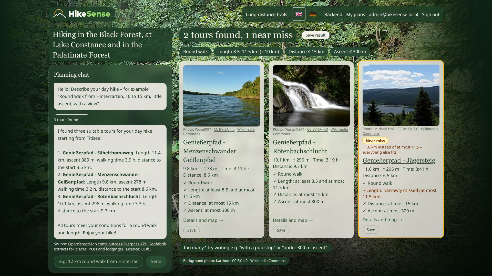

# Hike all about

A hiking planner for the **Black Forest, Lake Constance (with the Swiss and Austrian shore) and the Palatinate Forest** that you use through an AI chat. It plans day hikes and multi-day tours on eight long-distance trails, with places to stay, walking times and weather. Every route comes from the database, not from the language model, and the code checks every number in the answer against the tool results.

The app is bilingual: English by default, German with one click (🇬🇧 / 🇩🇪).

**Videos:** user demo, technical overview and an AI deep dive (EN + DE) – see [Demo videos](#demo-videos).



## Why

A real trip was the starting point: three days in the Black Forest, about 15 km a day, three rooms booked in a row, a plan B for rain. Finding *a* trail was easy. Making **route, overnight stay and weather fit together** took days.

The predecessor HikeAI (Sprint 2) was criticised for three things, and this project answers each of them:

| HikeAI | Hike all about |
|---|---|
| Silently dropped wishes ("round walk, under 200 m ascent, over 15 km" returned a route that was not a round walk) | Every condition is checked in code and shown as ✓/✗. If nothing fits, the app says why and shows tours that miss exactly one condition |
| Only a list of results, no planning | Multi-day plans with a room ≤ 1 km from the trail each night, arrival times, weather, rain variant; changes in the chat ("make day 3 shorter") |
| Unclear data provenance | Every row has a source and licence; photos, knowledge answers and the map show theirs |

## What it does

- **Day hikes:** up to 5 tours around a start place, each with ✓/✗ per condition (length, ascent, duration, round walk, features such as "café on the way"). With only 1–2 hits the list is filled up with *near misses* that miss one condition by at most 25 %.
- **Multi-day tours** on Westweg (two variants), Mittelweg, Ostweg, Pfälzer Weinsteig, Pfälzer Waldpfad, Jubiläumsweg Bodenseekreis and SeeGang: days with a target distance, a place to stay per night, arrival times (DIN 33466, no breaks), weather and a rail rain variant.
- **Weather day finder:** "a round walk near Titisee in fine weather" finds the matching days in the 14-day Open-Meteo forecast.
- **Knowledge questions** ("How is the Westweg waymarked?") are answered only from an indexed source (Wikipedia, Wikivoyage, own texts), always with source and licence.
- **On the trail (PWA):** your position on today's stage, remaining km and estimated arrival – computed in the browser, nothing is sent.
- **Accounts and roles:** saved plans and saved searches, private photo uploads; an admin backend (`/admin`) shows every search with the model's prompts, tool calls, costs and timings.
- **Hiking groups and races:** a curated club list and a live race search where every field needs a verbatim quote from the organiser's page.

## How it works

```mermaid
flowchart LR
    web["Web app<br/>Next.js PWA"] -->|"POST /api/chat + Supabase token"| api["API<br/>FastAPI"]
    web <-->|"sign-in, plans, photos"| sb[("Supabase<br/>Postgres + PostGIS")]
    api --> graph["LangGraph agent"]
    graph -->|"SQL"| sb
    graph -->|"structured output,<br/>tool calls, answer"| llm["LLM via OpenRouter<br/>gpt-4o-mini"]
    graph --> idx[("Knowledge index<br/>ChromaDB + BM25")]
    graph --> meteo["Open-Meteo"]
    api -->|"Server-Sent Events (JSON)"| web
```

One chat message runs through a LangGraph graph (`backend/src/hikeall/agent/graph.py`):

1. **guard** – input protection (prompt injection, off-topic) without the model.
2. **understand** – one *structured-output* call: the model turns the message into JSON that matches the Pydantic schema `RawRequest`. The code then resolves places and features and keeps only numbers the user actually wrote.
3. **search / multiday / react / groups / events** – the code does the work: PostGIS search and condition checks, day planning, weather. Only knowledge questions (`react`) use classic tool calling: the model gets JSON function specs and asks for `get_trail_details`, `find_accommodation`, `hiking_time` or `search_knowledge`; the code runs them and returns JSON (max. 8 calls).
4. **answer** – the model words the reply from the data the code prepared.
5. **ground** – every number and tour name in the reply is checked against the tool results; unsupported numbers are replaced by "?". The code's own honest sentences ("No tour meets all your wishes, because …") come first, verbatim.
6. **log** – one JSON line per turn, shown in `/admin`.

**The code decides, the model words it.** A step-by-step explanation with real JSON examples is in [docs/presentation/ki-ablauf.md](docs/presentation/ki-ablauf.md) (German and English).

## Data

| Data | Source (licence) | Amount |
|---|---|---|
| Long-distance trails | OSM relations (ODbL); stage split as facts from the trail operators | {{LONG}} |
| Day hikes | OSM hiking relations (ODbL), filtered by quality rules, curated in `data/curated/day_hikes.csv` | {{DAY}} |
| Places to stay, places, POIs | OSM (ODbL); Black Forest from the Geofabrik extract, the other regions via Overpass | {{LODG}} |
| Elevation | Copernicus DEM GLO-30 | all lines |
| Photos | Wikimedia Commons, author and licence per photo | {{PHOTOS}} |
| Knowledge index | Wikipedia, Wikivoyage (CC BY-SA 4.0) and own texts | {{KNOW}} |
| Map / weather | basemap.de (BKG, CC BY 4.0) / Open-Meteo (CC BY 4.0), at runtime | – |

The app never queries OSM at runtime; the import commands produce a fixed state.

## Evaluation

A fixed test set (`data/eval/cases.yaml`) runs against the real agent with `make eval` and is checked by code. SMART targets: 0 % invented tours, ≤ 2 % unsupported numbers, 100 % openly named unsatisfiable requests, Recall@5 ≥ 0.8. Results, repeated runs and the model comparison: [docs/evaluation/](docs/evaluation/README.md).

{{EVAL}}

## Setup

Requirements: Docker, Node.js 20+, [uv](https://docs.astral.sh/uv/), an [OpenRouter](https://openrouter.ai) API key.

```sh
git clone <repo> && cd HikeAllAbout
cp .env.example .env
npx supabase start            # local Supabase (Postgres + PostGIS, Auth, Storage)
npx supabase status           # copy the anon key into SUPABASE_ANON_KEY in .env
```

In `.env` also set `OPENROUTER_API_KEY`, a random `HIKEALL_SMOKE_PASSWORD` and `HIKEALL_ADMIN_PASSWORD_HASH` (bcrypt hash, the command is in `.env.example`).

Import the data (takes a few hours; trails come from the public Overpass API, places and lodgings from local Geofabrik extracts):

```sh
make osm-extract   # Geofabrik extracts (BW, RLP, Schwaben, CH, AT; ~2 GB, once)
make import        # long-distance trails, day hikes, surface shares, tags, photos (Overpass API)
make places        # places, POIs and lodgings from the extracts, then tags
make knowledge     # knowledge index (downloads the embedding model on first run)
make groups        # curated hiking groups
```

Start the app:

```sh
make up            # Supabase + API (:8000) + web app (:3000) in Docker
make admin-user    # local admin: sign in as "admin"
```

Open http://localhost:3000, create an account (no e-mail confirmation locally) and try:

- "A round walk near Titisee, about 10 km"
- "Round walk, under 200 m ascent, over 15 km, Feldberg"
- "3 days on the Westweg from Hausach", then "make day 3 shorter"
- "Round walk in the Palatinate Forest with a place to eat"
- "How is the Westweg waymarked?"

Tests: `make test` (backend + web). Smoke test against the real model: `make smoke-user && make smoke` (about $0.01). On a phone: `cloudflared tunnel --url http://localhost:3000` gives an HTTPS address for location and installation.

**LangSmith (optional):** with `LANGSMITH_TRACING=true`, `LANGSMITH_API_KEY`, `LANGSMITH_ENDPOINT=https://eu.api.smith.langchain.com` and `LANGSMITH_PROJECT=hikesense` in `.env`, every chat turn appears in LangSmith as a tree of graph nodes, LLM calls and tool calls, tagged with the `request_id` of the `/admin` log line. Off by default; when on, messages and prompts are stored by LangChain Inc. (EU region) – the user id and e-mail are never sent.

Costs are capped at $0.05 and 8 tool calls per message, and at 10 messages per minute / 100 per day per account.

## Demo videos

Recorded with `scripts/video/` (Playwright screen recording, slides, edge-tts narration):

- User demo (EN) – how a hiker uses the app
- Technical overview (EN) – data, quality rules, agent, evaluation
- AI deep dive (EN / DE) – how the agent calls its tools and where JSON is used

## Limits

- Room availability is unknown; the app links the place to stay, it does not book.
- OSM data can be outdated or incomplete; well-mapped areas are favoured.
- Grounding checks numbers, tour names and the "no tour fits" sentence – not every other statement.
- The test set is self-written and small; see the evaluation for what the numbers do not show.

More detail (German): [docs/details-de.md](docs/details-de.md) – features, multi-day rules, weather thresholds, admin log, tunnel, known gaps.
